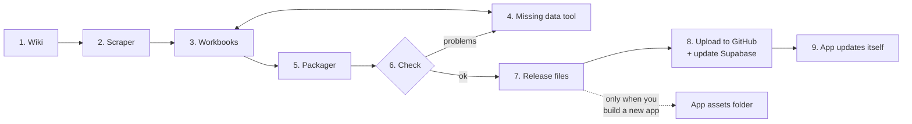
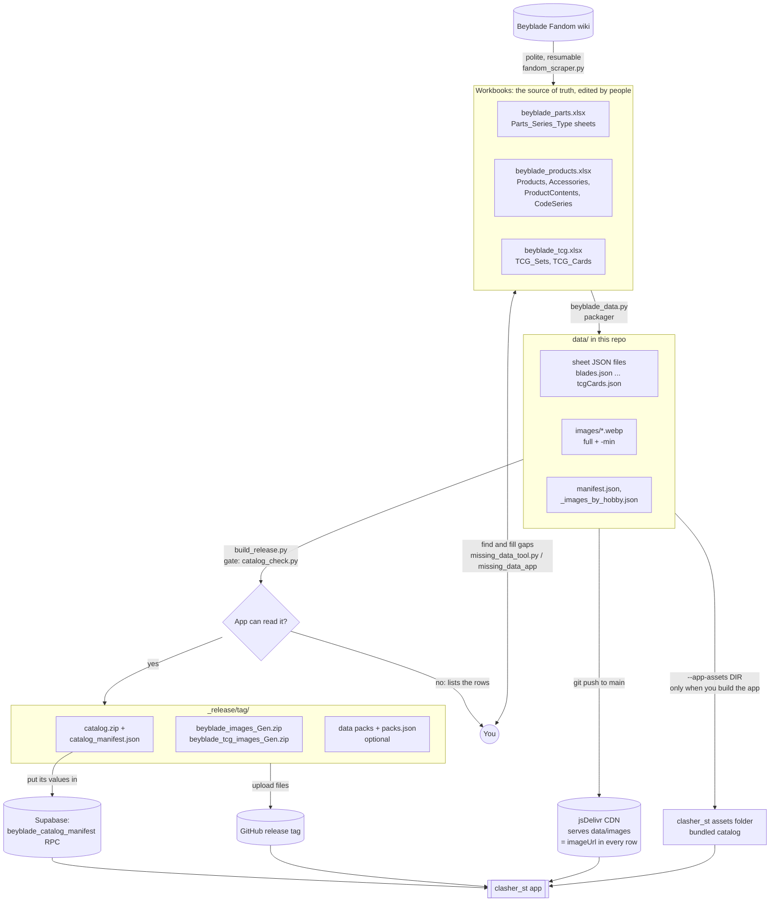
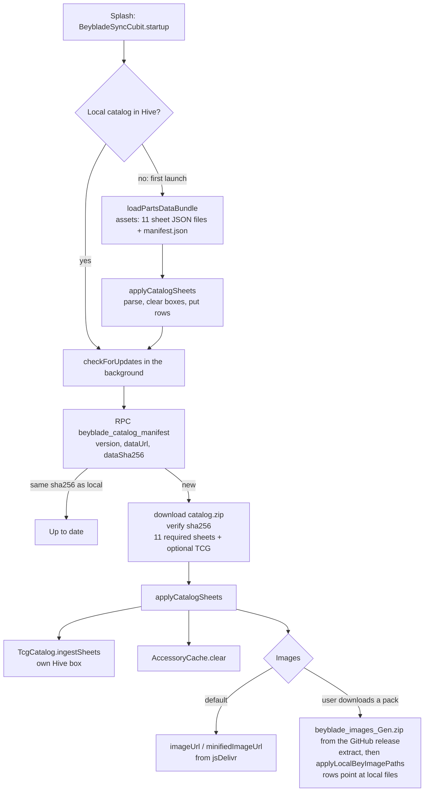

# Data workflow: wiki to app

This page covers how Beyblade data gets from the Fandom wiki into the clasher_st app, what each tool creates, and
what you publish where.

## In short



1. **Wiki**: the Beyblade Fandom wiki is where the data comes from.
2. **Scraper** (`fandom_scraper.py`): reads the wiki slowly and safely, and writes what it finds into the workbooks.
3. **Workbooks** (3 Excel files: parts, products, card game): the master copy. You can open and edit them.
4. **Missing data tool** (`missing_data_tool.py` or the Flutter `missing_data_app`): shows what's empty and helps you
   fill it in. It can also add what the scraper didn't create: **new rows** (blank, a variant of an existing part, or a
   copy) and **new columns**. Every change goes into the workbook's change log. Save when you're done.
5. **Packager** (`beyblade_data.py`): turns the workbooks into the `data/` folder (JSON files plus WebP images). New
   rows and columns go into the JSON automatically. It also prints what's new since the last package and what was
   done with the missing data tool. Commit and push `data/` to GitHub so the images are online.
6. **Check** (runs inside the release builder): makes sure the app can read everything. If something is missing, it
   lists the rows. Fix them (back to step 4), or skip them with `--drop-invalid`.
7. **Release files** (`build_release.py --tag <date>`): builds `catalog.zip` (all the data in one file) and the
   image packs in `_release/<tag>/`.
8. **Upload**: create a GitHub release with that tag and upload the files. Then put the printed
   `catalog_manifest.json` values where your Supabase `beyblade_catalog_manifest` function reads them.
9. **App**: on its next launch the app sees the new version, downloads `catalog.zip`, checks it and switches over.
   Nothing to do on the phone.

**All of it from one app:** Clasher Studio (`clasher_st_missing_data/`) runs every step above from its sections:
**Scrapers** (step 2, with each generation's own scraper code), **Data** (step 4), **Publish -> Data release**
(steps 5 to 8, one button per step, each confirmed before anything is pushed or uploaded) and **Publish ->
Packaging** (which columns each JSON gets and which ones block the release). Language packs go to a different repo:
**Publish -> Translations release**. The command lines below still work the same.

**Assets folder:** only when you build a new version of the app. Add `--app-assets <folder>` in step 7 and it writes
the copy of the data that ships inside the app (used on first launch and offline). Images are never put in assets.

## The whole flow (detailed)



## What each step creates

| step | command | creates |
|---|---|---|
| scrape | `python fandom_scraper.py` (GUI) or `--target parts:X:blades ...` | rows and images in the three workbooks, `scrape_state/` (resume point and log) |
| fill gaps | `python missing_data_tool.py` or the `missing_data_app` | edits, new / deleted rows, id shifts and new columns in the workbooks (each edit stamps `updated_at`); the `_deleted` tab (recently deleted rows with their pictures); the `_edit_log` tab (every change: when, tool, tab, row, field, old → new) and the `_columns` tab (columns added with the tool); a `.bak` on every save |
| package | `python beyblade_data.py --parts ... --products ... --tcg ... --out data` | `data/<sheet>.json` for every sheet (including new rows and columns), `data/images/<sheet>-<id>[-min].webp`, `manifest.json` (with a `changes` summary), `_images_by_hobby.json`, `_package_diff.json` (rows/columns added, removed or changed since the last package), `_edit_log.json`, `_custom_columns.json`, and a catalog check report |
| release | `python build_release.py --tag <tag> [--drop-invalid] [--app-assets DIR]` | `_release/<tag>/`: `catalog.zip`, `catalog_manifest.json`, image packs, data packs, `packs.json` (and the bundled catalog in `DIR`) |
| check only | `python catalog_check.py --data data` | a report; exits 1 when the app would reject or break on the data |

What the packager does on the way out:
* rows marked `deleted` are left out;
* ids become text (`65` becomes `"65"`), the shape your models read;
* `ProductContents.partType` becomes the key the app resolves (`Parts_X_Blades` becomes `blades`, `Accessories`
  becomes `accessories`);
* X parts keep their file names (`blades.json` ...). Other series are prefixed (`burstLayers.json`) and ignored by
  the app for now;
* columns added with the missing data tool are written like any other field. The app reads only the fields its models
  know, so a new column is ready for the app once a model reads it.

## The release gate

`build_release.py` runs `catalog_check.py` before writing anything. The checks match what the app does:

| check | why |
|---|---|
| all 11 sheets the app requires are present: `blades`, `ratchets`, `bits`, `lockChips`, `overBlades`, `metalBlades`, `mainBlades`, `assistBlades`, `products`, `accessories`, `productContents` | `downloadCatalogSheets()` rejects a release missing any of them; the bundled loader fails the first launch |
| no row has an empty field the models read with `requiredString` (`dataID`, `manufacturer`, `hobbyName`, `hobbyGeneration`, `code`, `name`, `wbolegality`, plus `type`/`spinDir` on blades, `baseName`/`movementStyle` on bits ...) | rows are parsed when a screen reads them, so one bad row makes `getAllBlades()` throw after the update has already been applied |
| no duplicate ids in a sheet | rows are stored by `dataID`; a duplicate silently replaces the other |
| ProductContents point at a type the app resolves, and the part exists | the product detail ("in the box", stock combos) looks them up by key |

On errors it writes nothing and lists the rows. Fix them in the workbooks (the missing data tool shows them field
by field) and re-package. Or run with `--drop-invalid` to release without those rows; they come back once they're
complete. Rows marked `incompleteData` with an empty `type` are the usual case.

## Inside the app



## Do I need to put the data in the assets folder?

**Yes, once per app build, not once per data release.**

* The app ships a **bundled catalog** for its first launch and for offline use. `loadPartsDataBundle()` reads
  `<AppConstants.beyBladePartsAssetpaths>/<sheet>.json` for all 11 required sheets, plus `manifest.json`. If any of
  them is missing, the first launch has no catalog at all.
* Between app builds you **don't** touch the assets. New data reaches installed apps through the release
  (`catalog.zip` and the manifest RPC).
* When you build a new app version, refresh the bundled copy so new installs start on current data. Write it with
  the same gate as the release:
  ```bash
  python build_release.py --tag <tag> --app-assets ../clasher_st/assets/<your beyBladePartsAssetpaths folder>
  ```
  This writes exactly the 11 sheets and `manifest.json`, already checked. The folder must be listed under
  `flutter: assets:` in the app's `pubspec.yaml` (it already is if the current bundle loads).
* **Images are never bundled.** Rows carry jsDelivr URLs, and users can download image packs. The TCG sheets aren't
  bundled either: they arrive with the first downloaded release.

## Release checklist

1. Scrape and/or edit the workbooks. Check gaps in the missing data tool and fill them.
2. Package:
   ```bash
   python beyblade_data.py --parts beyblade_parts.xlsx --products beyblade_products.xlsx --tcg beyblade_tcg.xlsx --out data --user discoballonmyhead --repo clasher_st_beyblade_assets
   ```
   The report at the end shows what the gate will say.
3. Commit and push `data/` to `main`. Row `imageUrl`s point at `cdn.jsdelivr.net/gh/<user>/<repo>@main/data/images/`,
   so images must be on `main` before the app sees the new rows. jsDelivr caches `@main` for up to about 12 hours.
   Purge `https://purge.jsdelivr.net/gh/<user>/<repo>@main/data/images/<file>` if you replaced an existing image.
4. Build the release:
   ```bash
   python build_release.py --tag 2026-11-03
   ```
   Add `--drop-invalid` to skip incomplete rows. Add `--app-assets DIR` when you're also building the app.
5. Create the GitHub release `<tag>` and upload every file in `_release/<tag>/`.
6. Make the `beyblade_catalog_manifest` RPC return the printed `catalog_manifest.json` values (`version`,
   `releaseTag`, `dataUrl`, `dataSha256`, `publishedAtMillis`), wherever your RPC reads them from. Apps pick up the
   new catalog on their next launch. An unchanged catalog produces the same `dataSha256`, so apps don't re-download.
7. If the image-pack release tag changed, update `AppEnv.githubReleaseTag` (the asset download cubit reads packs from
   that tag).

## How it was verified

* Full run on `samples/`: package, then release with `--app-assets`, then a Dart test in a stand-in `clasher_st`
  package that uses the app's own `beyblade_cat_remdsrc.dart`, `beyblade_bundle_parser.dart` and `models.dart`. The
  test:
  * serves `catalog.zip` to the real `downloadCatalogSheets()`;
  * runs `parseMetadataSheets`;
  * turns every row into an entity;
  * resolves every ProductContents row;
  * ingests the TCG sheets;
  * loads the bundled assets the way `loadPartsDataBundle()` does.

  It passes (`flutter_integration/test/release_contract_test.dart`).
* The `data/` currently in the repo, made by the old packager, is refused by the gate: 71 incomplete blades have no
  `type`, and ProductContents use sheet names. Forced through anyway, the app's models fail on it.
* The stand-in `requiredString` treats null or blank as missing. The real one is in
  `core/utils/sheet_row_parsing.dart`, which wasn't in the zip. If yours accepts null, the gate is stricter than
  needed but never wrong.
